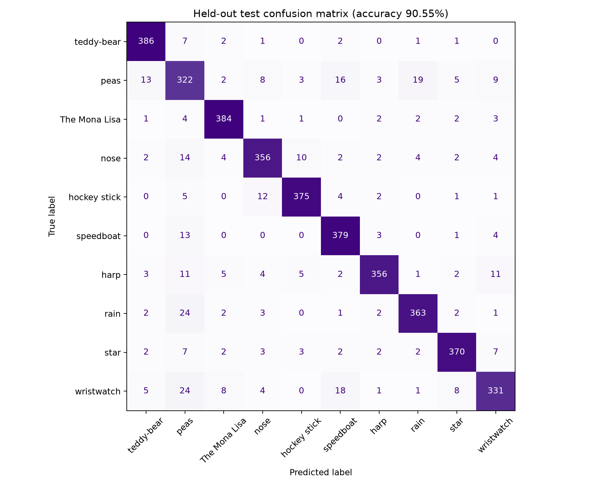
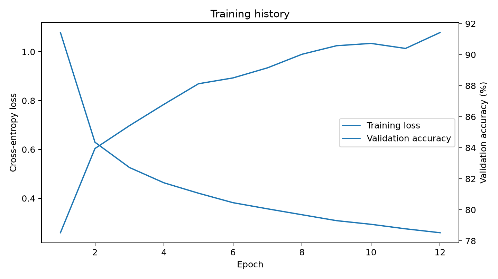

# Drawing: A New Way To Search

A drawing-first search prototype based on the Quick, Draw! bitmap dataset. Users sketch an object on a canvas; a compact convolutional neural network predicts the most likely category and provides a one-click web-search link for the top result.

## What is included

- `app.py` - Streamlit drawing canvas and prediction interface.
- `train.py` - balanced train/validation/test split, CNN training, and evaluation outputs.
- `scripts/download_data.py` - downloads the selected QuickDraw NumPy bitmap files.
- `src/model.py` - compact CNN model.
- `src/preprocess.py` - sketch preprocessing aligned with the 28 x 28 bitmap input.
- `src/data.py` - class list and dataset loading helpers.
- `tests/` - smoke tests for preprocessing and model dimensions.
- `config/classes.txt` - the ten classes used in the source paper's ten-class experiment.
- `Doodle_Recognition.ipynb` - interactive Jupyter / Google Colab notebook for exploring and training on QuickDraw categories.

A pretrained model checkpoint is included in `artifacts/model.pt` so you can launch the app immediately. Raw QuickDraw bitmap data files (~1.2 GB) are excluded from version control and can be downloaded locally using `scripts/download_data.py` if you wish to retrain.

## Requirements

Python 3.10 or newer is recommended. Install dependencies in a virtual environment.

### Windows PowerShell

```powershell
py -m venv .venv
.\.venv\Scripts\Activate.ps1
python -m pip install --upgrade pip
pip install -r requirements.txt
python scripts/download_data.py
python train.py --samples-per-class 4000 --epochs 12
streamlit run app.py
```

### Linux / macOS / WSL

```bash
python3 -m venv .venv
source .venv/bin/activate
python -m pip install --upgrade pip
pip install -r requirements.txt
python scripts/download_data.py
python train.py --samples-per-class 4000 --epochs 12
streamlit run app.py
```

Open the local address printed by Streamlit. Draw with the mouse or touchpad, select **Find what I drew**, and inspect the top predictions. To keep training practical on a laptop, the default command samples up to 4,000 drawings per class from the available bitmap files; increase that value or omit the cap only if you have enough memory and time.

## Run tests

```bash
python -m unittest discover -s tests -v
```

## Training outputs & Evaluation

Training saves the selected validation-best checkpoint to `artifacts/model.pt`, evaluation metrics to `artifacts/metrics.json`, and confusion-matrix / training-history plots to `artifacts/`.

- **Test Accuracy**: **90.55%** (held-out test split of 4,000 samples)
- **Best Validation Accuracy**: **91.43%**
- **Samples**: 4,000 per class (32,000 train / 4,000 val / 4,000 test) across 10 classes

| Confusion Matrix | Training History |
| :---: | :---: |
|  |  |

## Dataset

The project uses the NumPy bitmap files hosted by Google at:

`https://storage.googleapis.com/quickdraw_dataset/full/numpy_bitmap/<category>.npy`

The Quick, Draw! Dataset contains approximately 50 million drawings over 345 categories and is released under CC BY 4.0. See the [official dataset repository](https://github.com/googlecreativelab/quickdraw-dataset) and [CC BY 4.0 license](https://creativecommons.org/licenses/by/4.0/). The source paper also describes a 28 x 28 bitmap representation and an 80:10:10 train/validation/test split.

## Reproducibility notes

- The seed defaults to `42` and can be changed using `--seed`.
- The script records the class order in the checkpoint so inference labels stay aligned with model outputs.
- The exact accuracy depends on sample count, random split, training epochs, library versions, and hardware.
- The source paper's reported 81.87% test accuracy was obtained by its authors on a 50-class CNN experiment. It is a literature benchmark, **not** a claimed result for this ten-class implementation.

## GitHub publishing

This folder is a repository-ready project. After creating an empty repository on GitHub, set the remote and push:

```bash
git init
git add .
git commit -m "Initial implementation of drawing-based search"
git branch -M main
git remote add origin https://github.com/srujangithubit/ML-Drawing-A-New-Way-To-Search.git
git push -u origin main
```

Do not commit downloaded dataset files, virtual environments, or large binary files; `.gitignore` excludes these by default.
